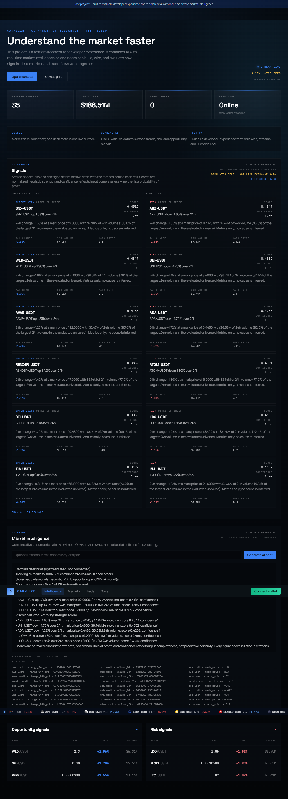
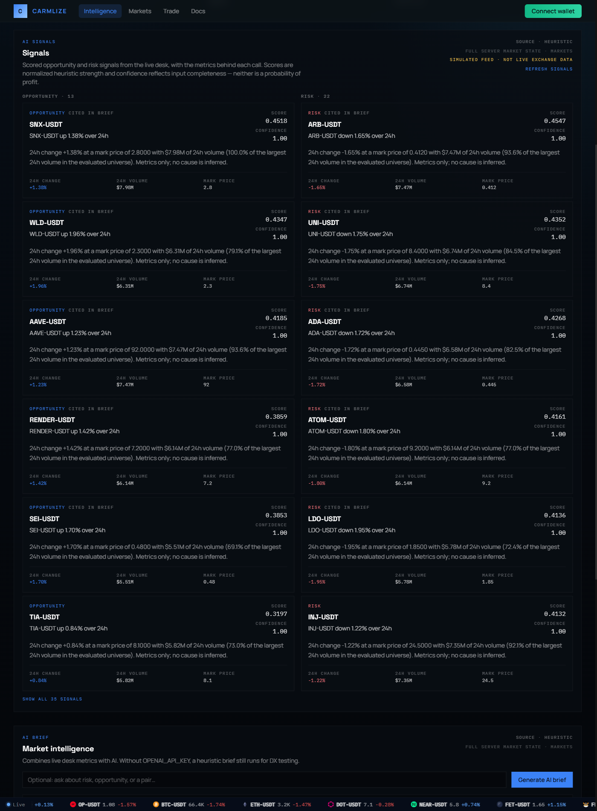
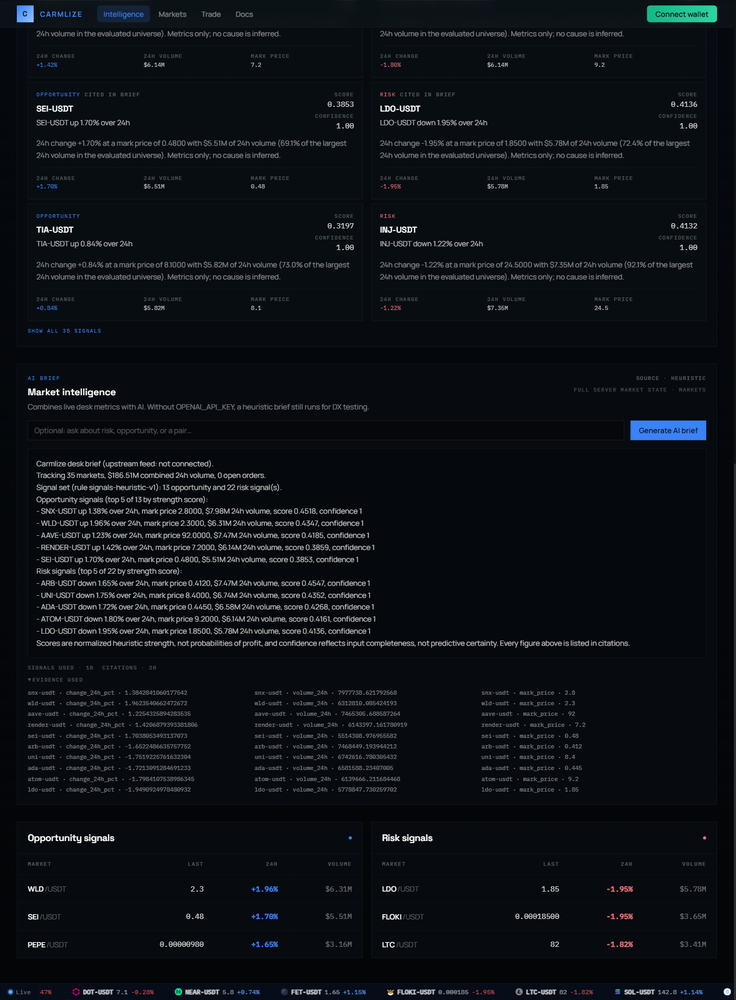

# AI Market Intelligence Dashboard

A crypto market dashboard where the AI layer is built to be **checkable**, not just convincing. Every
number a signal or a brief shows comes from the market data the dashboard is already rendering.

Most "AI market summary" implementations ask a model what happened and hope the numbers are right.
This one splits the job in two. A deterministic signal engine reads the market data, scores each
market, and records the exact metrics behind every score. A brief is then composed from those
signals. A language model is optional and, when configured, only gets to reword the prose, with its
answer thrown away if it references a market that isn't in the signals it was given.

**Live demo:** <https://ai-market-intelligence-dashboard-eta.vercel.app/dashboard>

Built with Next.js 14 (App Router), React 18, TypeScript and Tailwind. No API key required.



## What it does

- **Scores every market in the universe** into opportunity and risk signals with a strength score,
  a confidence value, and an `evidence` block holding the source metrics verbatim.
- **Composes a desk brief from those signals**, listing the `(market_id, field, value)` triples it
  used as citations plus the ids of the signals it was built from.
- **Renders it on the dashboard**: signal cards with score, confidence, headline, reasoning and the
  three evidence metrics, alongside a brief panel with its citations and an expandable evidence list.
- **Stays honest about the data source.** When the upstream exchange socket isn't connected, the
  header and the signals panel both say `simulated feed · not live exchange data`, and the brief says
  `upstream feed: not connected`.
- **Survives provider failures.** Rate limits, empty completions, truncated responses and unrelated
  output all fall back to the deterministic brief rather than surfacing an error or a bad brief.

### Screenshots

| | |
|---|---|
|  |  |
| **Signal cards** — opportunity/risk counts, provenance badges, the simulated-feed notice, and per-signal evidence | **Grounded brief** — the composed brief with `signals used`, `citations`, and the expandable evidence list |

> The screenshots were captured with the simulated feed active, which is why the counts in the two
> views differ from the full dashboard image: the seeded values are randomised per process start.

## How it works

```
market data (lib/marketEngine.js, 35 seeded markets + optional Binance feed)
      │
      ├─ GET /api/v1/markets, /api/v1/dashboard/summary
      │
      ▼
lib/aiRequest.js        validate the request, choose the market universe
      │
      ▼
lib/aiSignals.js        deterministic scoring + evidence  →  POST /api/v1/ai/signals
      │
      ▼
lib/aiBrief.js          grounded prose + citations       →  GET|POST /api/v1/ai/brief
      │
      ▼
/dashboard              signal cards, brief panel, evidence
```

The signal engine is pure: no network, no clock, no randomness, no LLM. Identical input produces
identical signals, which is what makes the test suite and the eval harness meaningful.

### Scoring

```
magnitude    = |change_24h_pct| / (|change_24h_pct| + 5)                     → [0, 1)
volumeWeight = volume_24h / maxVolume(field-valid markets in this universe)  → [0, 1]
score        = clamp01(0.70 × magnitude + 0.30 × volumeWeight)
confidence   = 0.5 × (required fields valid) + 0.5 × (volume_24h > 0)
```

`score` is **normalized signal strength**, not a probability of profit or an expected return.
`confidence` is a **data-quality indicator**: it only rises when the required fields are valid and
the market actually traded. Neither is predictive.

`volumeWeight` is measured against the other markets evaluated in the same call, so scores are
relative to that universe. The same market can score slightly differently in a 35-market run than in
a 6-market run.

### What keeps it grounded

- A record is scored only when `id`, `pair`, `mark_price > 0`, `change_24h_pct` (finite) and
  `volume_24h >= 0` are all present. Values are never coerced, so the string `"66420"` is rejected
  rather than parsed, and a missing value is never treated as `0`. Bad records are skipped and
  reported in `warnings`.
- `evidence` carries the source values **verbatim** — no rounding, no reformatting, no derived numbers.
- Direction always comes from `change_24h_pct`, never from the bucket a market was listed in. The
  dashboard summary's `top_gainers` is a positional slice, not a direction-filtered set, and with
  fewer than six markets the buckets overlap, so a loser can appear in `top_gainers`.
- `citations` are exactly the triples the brief prints. `signals_used` are real signal ids, and each
  market yields at most one signal, so a brief can never cite two contradictory calls for one pair.
- Model output is treated as untrusted. It must reference pairs the signals support, and it must
  mention at least one of them. Truncated (`finish_reason: "length"`) and filtered completions are
  discarded. Any rejection returns the deterministic brief with `source: "heuristic_fallback"`.

## API

### `POST /api/v1/ai/signals`

Evaluates the full server-side market state by default. Send an empty body, or supply
`{ "summary": <dashboard summary> }` to evaluate a specific universe (never merged with server state).

```json
{
  "signals": [
    {
      "id": "opportunity-snx-usdt",
      "pair": "SNX-USDT",
      "market_id": "snx-usdt",
      "type": "opportunity",
      "score": 0.4518,
      "confidence": 1,
      "headline": "SNX-USDT up 1.38% over 24h",
      "reason": "24h change +1.38% at a mark price of 2.8000 with $7.98M of 24h volume (...). Metrics only; no cause is inferred.",
      "evidence": { "change_24h_pct": 1.3842841060177542, "volume_24h": 7977738.621792568, "mark_price": 2.8 }
    }
  ],
  "source": "heuristic",
  "model": null,
  "generated_at": 1710000000,
  "warnings": [],
  "universe": "markets",
  "data_source": "server"
}
```

### `GET` / `POST /api/v1/ai/brief`

Optional body: `{ "question": "..." }` (capped at 500 characters). Returns the brief, its citations,
the ids of the signals it used, and the generation source (`heuristic`, `openai` or
`heuristic_fallback`).

Both endpoints return plain-text errors, `400` for a bad request (malformed JSON is never treated as
"no summary"), `503` while market state is warming up or unavailable, `500` otherwise. Never a stack
trace, and never a fabricated empty success.

## Getting started

Requires **Node.js 18+** and npm.

```bash
npm install
npm run dev          # → http://localhost:3000/dashboard
```

No configuration is required. `npm install` needs no registry token, and the app has no private
services or local file dependencies.

| Command | Purpose |
|---|---|
| `npm run dev` | Dev server on port 3000 (HTTP + a `/ws/markets` WebSocket) |
| `npm run build` | Production build |
| `npm start` | Production server (run `npm run build` first) |
| `npm test` | Unit and endpoint tests (`node --test`) |
| `npm run eval:ai` | Offline golden-set evaluation of the AI layer |
| `npm run typecheck` | `tsc --noEmit` |

### Environment variables

All optional. Copy `.env.example` to `.env.local` if you want to change anything.

| Variable | Default | Purpose |
|---|---|---|
| `PORT` | `3000` | Dev/production server port |
| `OPENAI_API_KEY` | — | Unset → deterministic `heuristic` brief, no network call |
| `OPENAI_BASE_URL` | `https://api.openai.com/v1` | Any OpenAI-compatible endpoint |
| `OPENAI_MODEL` | `gpt-4o-mini` | Model slug |
| `OPENAI_MAX_TOKENS` | `900` | Completion budget (reasoning models need headroom) |

The LLM path runs on any OpenAI-compatible provider, so a free OpenRouter model is enough to try it:

```bash
OPENAI_API_KEY=<key>
OPENAI_BASE_URL=https://openrouter.ai/api/v1
OPENAI_MODEL=liquid/lfm-2.5-2.6b:free
```

## Tests and evaluation

```
$ npm test
ℹ tests 146
ℹ suites 24
ℹ pass 146
ℹ fail 0
```

```
$ npm run eval:ai
Carmlize AI eval — 5 fixture(s)

  ✓ 01-mixed-desk                6 signals (3 opp / 3 risk), 0 warnings
  ✓ 02-all-gainers               4 signals (4 opp / 0 risk), 0 warnings
  ✓ 03-dirty-input               1 signals (1 opp / 0 risk), 4 warnings
  ✓ 04-large-universe            35 signals (18 opp / 17 risk), 0 warnings
  ✓ 05-buckets-only              3 signals (1 opp / 2 risk), 2 warnings

Checks: 1036 passed, 0 failed
Result: PASS
```

The tests cover the parts that would be easy to get quietly wrong: evidence values matching the
source summary verbatim, direction derived from metrics rather than buckets, missing fields being
skipped instead of zeroed, unsupported pairs and generic model output being rejected, malformed JSON
returning `400`, and determinism across identical inputs.

The eval runs offline with no key and no server. It checks schema and required keys, that every
`evidence` value equals the fixture summary, direction consistency, determinism, the no-key path, and
a 200 ms per-fixture latency budget.

## Deployment

Deploys to Vercel with no configuration — it's a standard Next.js app at the repository root. There
are no required environment variables and nothing needs to be provisioned.

Two things differ from local development:

- **The WebSocket stream (`/ws/markets`) is local-only.** It needs the long-lived custom server in
  `server.js`, which a serverless platform doesn't run. The dashboard polls the summary API every five
  seconds regardless, so the data still loads and updates.
- **Serverless instances don't share memory.** Each instance seeds its own markets, so values can
  differ between requests. That's fine for a demo but worth knowing.

## Known limitations

- **The market data is simulated.** The engine seeds 35 markets and randomises their opening prices
  per process start, and connects to Binance only if the custom server runs and the upstream is
  reachable. **Nothing here should be read as live exchange data.** The UI labels the feed state
  wherever it matters.
- **The OpenAI endpoint itself has not been exercised** — no OpenAI key was available. The
  OpenAI-compatible path was verified against OpenRouter's free tier with
  `liquid/lfm-2.5-2.6b:free`, which returned `source: "openai"` with a complete brief whose every
  figure matched its citations. The provider request contract is covered by tests that stub `fetch`.
- **Free providers are unreliable.** Rate limits, empty completions and reasoning models that spend
  the whole token budget thinking all occurred during testing, and all of them fall back cleanly.
- **Signals and the brief are separate requests**, so they're separate snapshots. Ids are stable, so
  citations and the "cited in brief" markers stay consistent, but live values can drift between the
  two panels.
- **`reactStrictMode` double-issues the signals request in development.** That's React's dev-only
  double invocation of mount effects. Production issues one.
- **Not investment advice**, and not a trading system. Nothing in the app places orders autonomously.

## Credits

The market engine, matching engine, trading UI shell and page layout come from the Carmlize market
dashboard starter. The AI layer — the signal engine, the grounding and citation contract, the brief
composition and fallback logic, the provider abstraction, the dashboard AI section, the test suite and
the eval harness — is the work in this repository.

No license file accompanied the starter code, so no license is asserted here.
